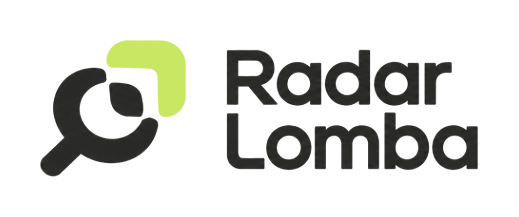
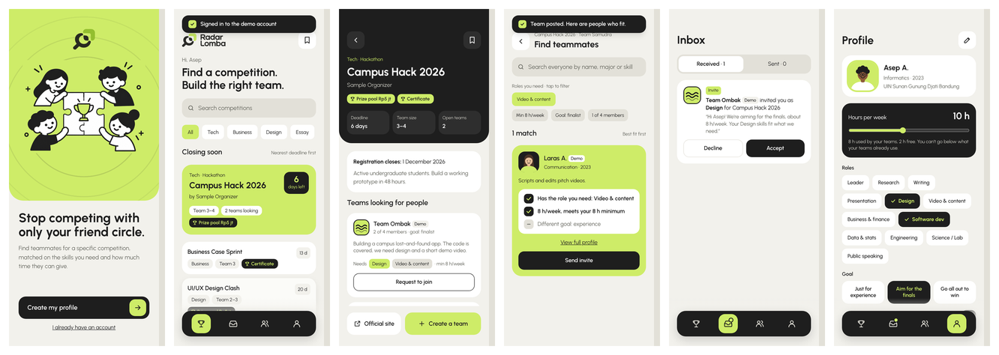
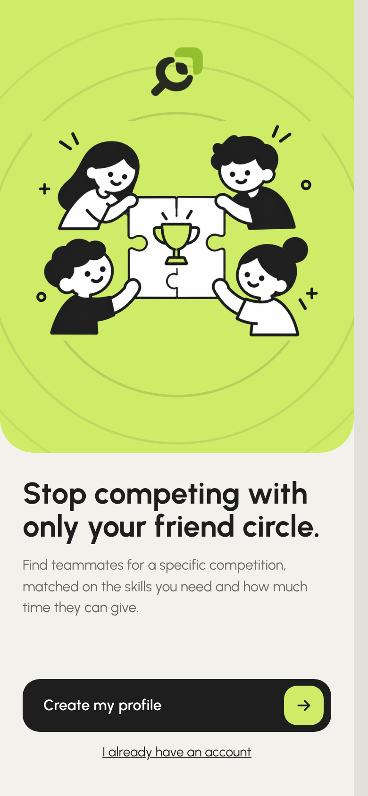
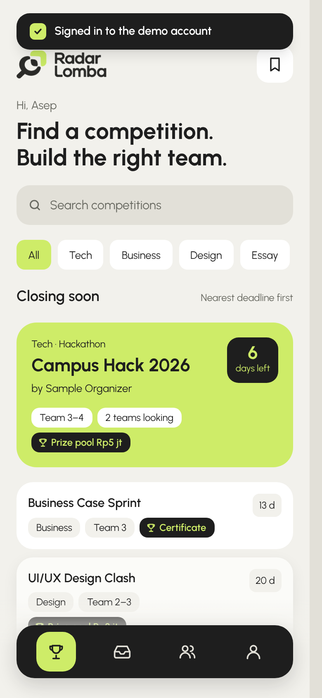
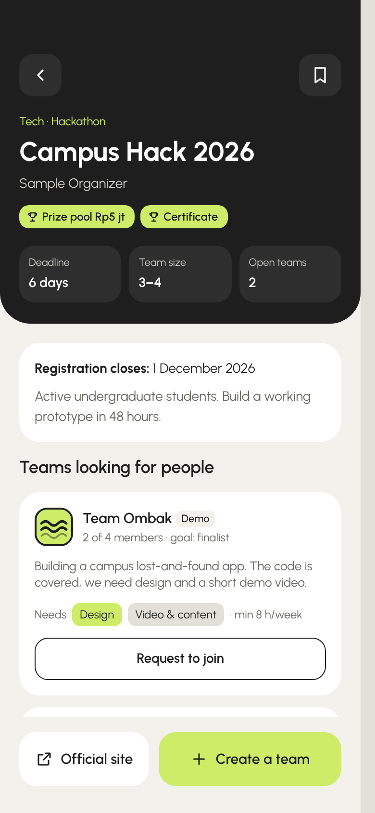
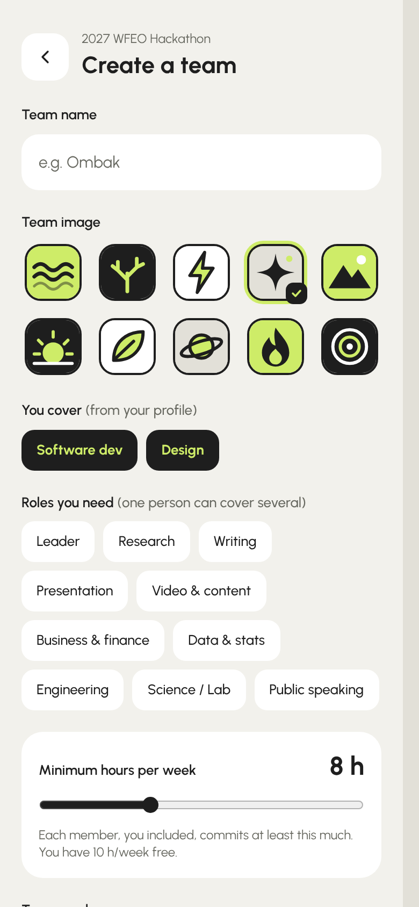
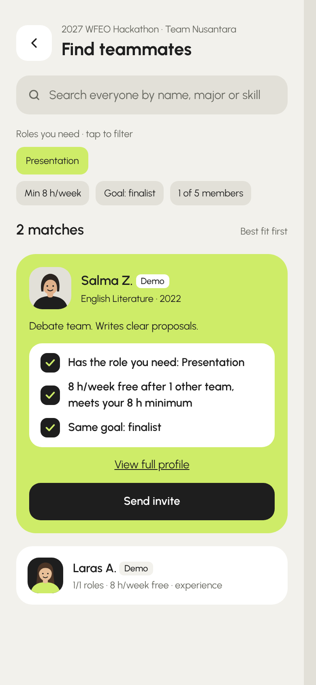
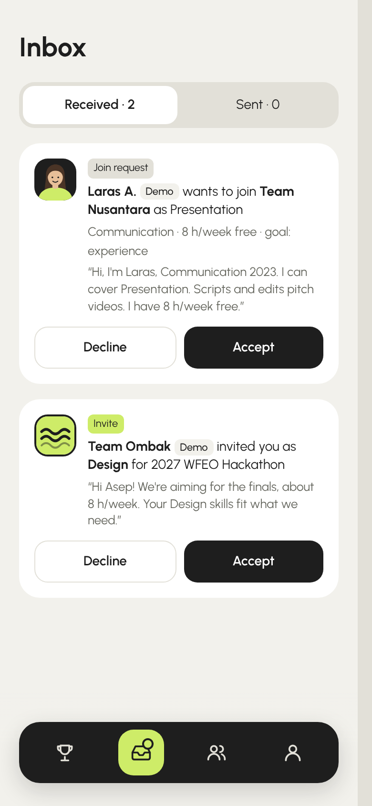

<p align="center">
  
</p>

<p align="center"><b>Find a competition. Build the right team.</b></p>

<p align="center">
  
</p>

<p align="center"><sub>Screens from the running prototype. All people, teams and competitions shown are demo data.</sub></p>

Radar Lomba helps undergraduates at one pilot campus (UIN Sunan Gunung Djati Bandung) form teams for a specific competition. A student opens a competition, posts a team with the roles it still needs, sees matching students, sends invites, and the team forms when people accept. Matching is plain rules (roles, free hours, goal). There is no AI in the product.

Built by team Xplover for **STACK 2026**, Case 1: Smarter Campus and Learning.

> **Status: semifinal prototype.** This repository is the **frontend only**. It runs on demo data stored in the browser (`localStorage`), so the whole flow can be clicked through without a backend. The real database and sign-in (Supabase) are planned for the Final Round and are not built yet. See [Complete vs not yet](#complete-vs-not-yet).

## Why it exists

Students who want to enter a competition usually look for teammates through chat groups and Instagram stories. They find the same friend circle, and they can't tell whether a stranger has the right skills or enough time. Radar Lomba puts the competition first: you see who is free, what they can do, and whether their goal matches yours.

## Quick start

Needs Node.js 20 or newer.

```bash
npm install
npm run dev
```

Open http://localhost:3000 in a phone-width window (Chrome DevTools, device toolbar), or on your phone over the same Wi-Fi.

```bash
npm run build   # production build
npm start       # serve the build
npm run lint    # type check (tsc --noEmit)
```

No environment variables are needed. `.env.example` lists the Supabase keys for later.

### Deploy to Vercel

1. Push this repository to GitHub.
2. On vercel.com choose **Add New → Project**, import the repository and keep the default Next.js settings.
3. Deploy. No environment variables are required for this preview.

## Try the core flow (about 2 minutes)

1. **Create my profile.** Email and password (demo: nothing is verified), pick one of 10 avatars and your name, choose your roles (12 cross-major roles), campus, major, entry year, weekly hours, goal and contacts.
2. A demo team invites you a few seconds later if your roles fit. Accept it in **Inbox**.
3. Open a competition. You see the teams looking for people, with the roles you have highlighted. Tap **Request to join**, pick your roles and write a short intro. A demo owner replies after about 5 seconds.
4. Or tap **Create a team**: name it, pick an image, choose the roles you need, minimum hours and goal. You then see matching students, each with a checklist of reasons (never a score). Tap **Send invite**. Demo students accept after about 4 seconds.
5. **My teams** shows your teams and your free hours. The team page has the registration countdown, members, the group link, **We're complete** and **Leave team**.
6. **Profile → Reset demo** starts over.

Shortcuts: on the sign-in page, "I already have an account" opens a ready-made demo account (Asep A.), and **Demo: open admin view** opens the admin pages.

## Screens

| Welcome | Competitions | Competition detail |
| :---: | :---: | :---: |
|  |  |  |
| Start here | Search, categories, closing soon | Rules, deadline, teams looking for people |

| Create a team | Find teammates | Inbox |
| :---: | :---: | :---: |
|  |  |  |
| Roles you need, hours, goal | Matches with reasons, no score | Accept or decline invites |

## Features

**Students**
- Competition list with search, category chips, saved competitions, rewards as tags and a "Closing soon" highlight.
- Competition detail: rules, deadline, team size, poster, official site, teams looking for people.
- Add a competition that is not listed. It shows as "Added by student". Only the person who added it can edit or delete it, and an admin can hide it.
- Team creation, candidate search, invite and join request flows, with a Sent and Received inbox.
- Profiles with roles, weekly hours, goal, contacts (WhatsApp required, Instagram and LinkedIn optional) and a portfolio where every item needs a proof link.
- Other students' profile pages, with Invite from the candidate list.
- Account settings (change email, password, contacts, delete account) and confirmation popups for risky actions.

**Admin (demo)**
- `/admin` lists competitions in two tabs: **Official** (remove) and **Added by students** (hide or unhide, with a "Possible duplicate" flag).
- `/admin/new` adds an official competition. Admins cannot open student pages and students cannot open `/admin`.

## Rules the app enforces

- One team per competition, but you can join several competitions.
- Hours are counted across teams. Each team you are in uses its minimum hours per week from your total. Search and join requests only allow people with enough free hours.
- A team turns **full** at the competition's maximum size and stops taking requests.
- Contacts are shown only on the profile of someone in the same team, never on public lists.
- Only the team owner can remove members. A removed person cannot request that team again.
- Empty teams are deleted, and pages that point to a deleted team, competition or account show a "no longer exists" message.
- The match score is only used to sort candidates. The UI shows reasons, never a number.

## How matching works

Everything is in one readable file: [`src/lib/matching.ts`](src/lib/matching.ts).

| Signal | Weight |
| --- | --- |
| Share of the roles the team needs that the student can cover | 60% |
| Free hours per week at least the team's minimum | 20% |
| Same goal as the team (experience, finalist, win) | 20% |

Students without enough free hours, or already in a team for that competition, are filtered out before scoring.

## Project structure

```
src/
  app/                  pages (Next.js App Router)
    onboarding/         4-step sign-up and profile setup
    competitions/       list, detail, poster, all teams, add or edit, join request, create team
    teams/              my teams, team page, candidates, edit team, team ready
    inbox/              received and sent, accept or decline
    profile/            profile, edit, account settings, portfolio
    users/              another student's profile
    saved/              saved competitions
    admin/              demo admin pages
  components/           bottom nav, icons, shared UI, forms
  lib/
    types.ts            data shapes (match the planned Supabase tables)
    seed.ts             fictional demo data
    matching.ts         score, free hours, eligibility rules
    contacts.ts         contact validation and links
    store.tsx           local demo store; each action maps to one Supabase call later
public/                 avatars, team images, illustrations, logo, PWA icons and manifest
```

Stack: Next.js 15 (App Router), React 19, Tailwind CSS 4, TypeScript 5.

## Connecting Supabase later

Replace the actions in `src/lib/store.tsx` (`createProfile`, `createRequest`, `sendInvite`, `sendJoin`, `respond`, `leaveTeam` and the rest) with Supabase queries on tables of the same names. `src/lib/types.ts` already follows that schema. Remove the demo auto-answer timer when real users answer. Row-level security rules replace the checks that the demo store does in code.

## Complete vs not yet

**Complete in this prototype:** every screen above, the multi-competition rules, form validation, empty and error states, and the PWA manifest and icons.

**Not yet:** real sign-in and real admin accounts, a database, server-side checks (RLS), poster storage (posters are small images kept in the browser), CSV import of competitions, push notifications, offline caching.

## Known limitations

- Data lives in one browser only. Clearing site data resets it.
- Competitions, teams and people are fictional and marked "Demo" or "Sample". Their links are placeholders.
- Demo profiles answer automatically after a few seconds so the flow can be shown without a second person.
- The sign-in and email steps are simulated. Nothing is sent.

## Third-party resources and AI assistance

- Next.js, React and Tailwind CSS (MIT licence). Font: Urbanist (Google Fonts, SIL Open Font Licence).
- Avatars, team images and illustrations were made for this project.
- **AI disclosure:** the product itself uses no AI. The code and design files were produced with an AI coding assistant (Claude) and reviewed by the team.
